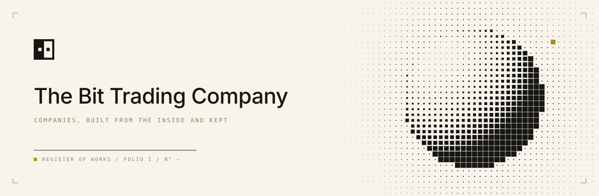

<picture>
  <source media="(prefers-color-scheme: dark)" srcset="https://raw.githubusercontent.com/Bit-Trading-Company/.github/main/profile/assets/banner-dark.svg">
  
</picture>

 

The Bit Trading Company forms partnerships and holds them past the point at which most parties stop holding.

What it makes are companies. Each is built from the inside, run by the people who built it, and kept for longer than is customary. Some of them are visible from here. Others are not visible yet, and a few may never need to be.

 

<picture>
  <source media="(prefers-color-scheme: dark)" srcset="https://raw.githubusercontent.com/Bit-Trading-Company/.github/main/profile/assets/rule-dark.svg">
  
</picture>

<code>FOLIO I</code>&nbsp;&nbsp;THE REGISTER

| | |
|:--|:--|
| CONCERN | Companies, built from the inside and kept |
| FIELDS | Machine intelligence, exchange, settlement, and the instruments that sit between them |
| HOLDINGS | A handful, at different stages of being true |
| METHOD | The small shift in a system that sets a larger one moving |
| POSTURE | Open where openness serves |
| HORIZON | Long |
| WHEREABOUTS | — |

 

<picture>
  <source media="(prefers-color-scheme: dark)" srcset="https://raw.githubusercontent.com/Bit-Trading-Company/.github/main/profile/assets/rule-dark.svg">
  
</picture>

<code>FOLIO II</code>&nbsp;&nbsp;IN THE OPEN

Most of the work is not public yet. What is public lives where it belongs, and is easier to find there than to list here.

- **The house** &nbsp;·&nbsp; [bit-trading-company.com](https://bit-trading-company.com/)
- **The laboratory** &nbsp;·&nbsp; [huggingface.co/Bit-Trading-Company](https://huggingface.co/Bit-Trading-Company)
- **The repositories** &nbsp;·&nbsp; below, as they are released

 

<picture>
  <source media="(prefers-color-scheme: dark)" srcset="https://raw.githubusercontent.com/Bit-Trading-Company/.github/main/profile/assets/rule-dark.svg">
  
</picture>

<code>FOLIO III</code>&nbsp;&nbsp;THE DOOR

| If you are | Go to |
|:--|:--|
| Proposing something | [contact@bit-trading-company.com](mailto:contact@bit-trading-company.com) |
| Reporting a weakness | [The security policy](https://github.com/Bit-Trading-Company/.github/blob/main/SECURITY.md), privately |
| Contributing to a repository | [The contributing guide](https://github.com/Bit-Trading-Company/.github/blob/main/CONTRIBUTING.md), then that repository's own |
| Looking for help | [Support](https://github.com/Bit-Trading-Company/.github/blob/main/SUPPORT.md) |

 

<picture>
  <source media="(prefers-color-scheme: dark)" srcset="https://raw.githubusercontent.com/Bit-Trading-Company/.github/main/profile/assets/rule-dark.svg">
  
</picture>

The name is a studio's. It is not a broker, an exchange, a fund or an adviser, and nothing here is an offer of anything. 
Some of the words in these repositories are drafted by software. Where that is so it is said, and a person answers for them.

